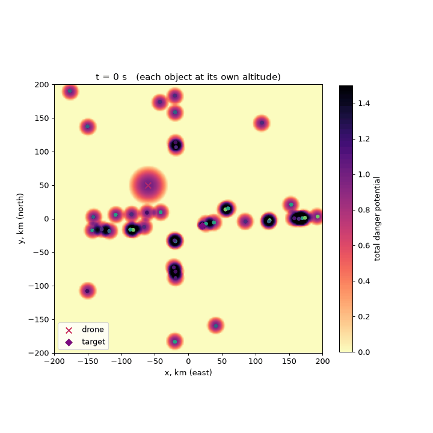
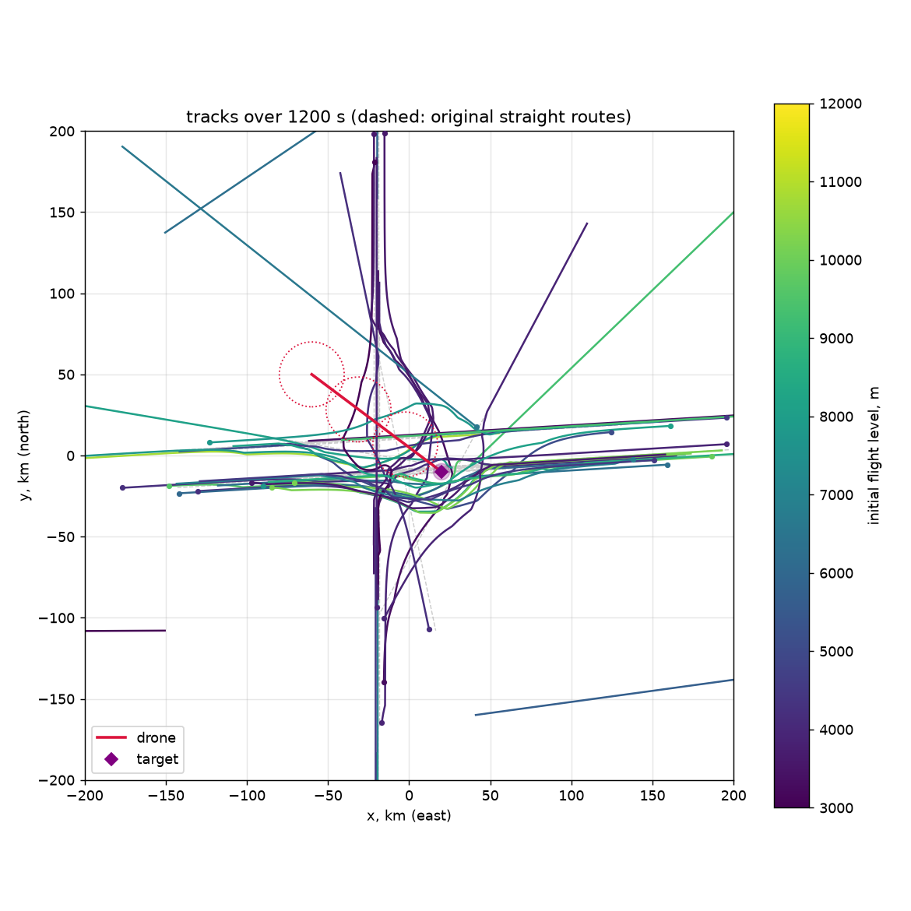

# Flight trajectories reconfiguration

## Scenario design
We treat the airspace as a distributed system, where each aircraft acts as an independent process
with its own local state and control decisions based on locally available observations.

Firstly, let's formulate Initial system with Safety/Liveness terms

### Initial system
**Safety** - not formulated (so is met)  
**Liveness** - planes must move in direction of (r0 + v0*t) | t = 1200 sec 
### System with collision resolving
**Safety**:
3D ICAO-like separation standard between planes (9260m horizontal, 300m vertical)+   
R=5km* vertical infinite column for drone target (explanation is at the bottom)+  
R=10km vertical infinite column for drone  
**Liveness** - planes must move in direction of (r0 + v0*t) | t = 1200 sec
#### Explanation
At t=0: F020 is 6.77 km from drone target and flying into it with closing speed of 199m/s.
With constraint of normal acceleration, F020 shortens distance to 5.4 km.
So we can't set a "hard" constraint of radius between target and plane bigger than 5.4 km.  

## Evidence
that the result meets new safety/liveness specification
- Independent checker was realized as a class, which checks simulation for rule violations
- There are verification tests in /tests, which run in CI and cover a part of scenarios. 
- The result is reproducible and deterministic

## Approach
### Plane state

Any object state is represented as (x, y, z, $V_{hor}$, $\psi$, $v_z$)  
Controls of a plane as $\quad \dot V=a_\tau,\quad \dot\psi=\omega,\quad \dot v_z=a_z$  
([flying_objects.py](src/flying_objects.py))

### Attention Object
Any object in system has its own potential $P_i(r, t)$, which represents the "danger" of existing near it  
Currently, for all objects it is representable as smoothed cylinder ([flying_objects.py](src/flying_objects.py))  
Any object reconstructs the expected potential of observed object 

### State of a system
State of a system at a fixed time is represented by the superposition of objects
and their potentials $\sum(P_i(r, t_{cur}))$ 

### Evolutional system
Evolutional system is solved as ODE of motion for any plane with RK4 integrator (just "The RK4").
$$
\dot{\mathbf s}=f(\mathbf s,\mathbf u):\qquad
\dot x=V\cos\psi,\quad \dot y=V\sin\psi,\quad \dot z=v_z,\quad \dot V=a_\tau,\quad \dot\psi=\omega,\quad \dot v_z=a_z .
$$

where
$\quad \dot V=a_\tau,\quad \dot\psi=\omega,\quad \dot v_z=a_z$  
are calculated by optimal controls algorithm 

### Controls
Receding-horizon sampling MPC over motion primitives ([controls.py](src/controls.py)).
Each plane runs this every 1 s, and all planes use the same snapshot of the world:

1. **Dimension of choices**: controls func. iterates over 45 maneuvers:
   $\psi^\star = \psi_{route} + \{0, \pm15^\circ, \pm30^\circ, \pm60^\circ, \pm90^\circ\}$,
   $z^\star = z + \{0, \pm600, +1500, +3000\}$ m.
2. **Potential convolution.** Convolution of all potentials along the own predicted path, with a decaying weight:
$$
J^D_c=\sum_{i}\int_0^{T}\frac{P_i\big(\hat{\mathbf r}_c(\tau),\,\tau\big)}{1+\tau/\tau_w}\,d\tau,\qquad T=120\text{ s},\ \tau_w=40\text{ s}
$$
3. **Cost.**
$$ J_c=\lambda_D J^D_c+\lambda_r\,(\text{cross-track})^2+\lambda_\ell\,(\text{progress lag})^2+\text{penalties: maneuver size, semicircular rule, decision switching} $$
5. **Choice.** $c^\star=\arg\min_c J_c$. Ties go to the smaller turn, i.e. **turn right**.

Symmetry between identical planes is broken by the convention:  
course $0$–$179^\circ$ prefers climbing, $180$–$359^\circ$ prefers descending  
ties are broken by turning right.

All weights and candidate options are in [rules_v1.json](rules/rules_v1.json).

## Assumptions
- in [rules_v1.json](rules/rules_v1.json) aircraft specifications

## Visualization

## PS
GitHub repo:
https://github.com/Oblepihovy/Airguard

